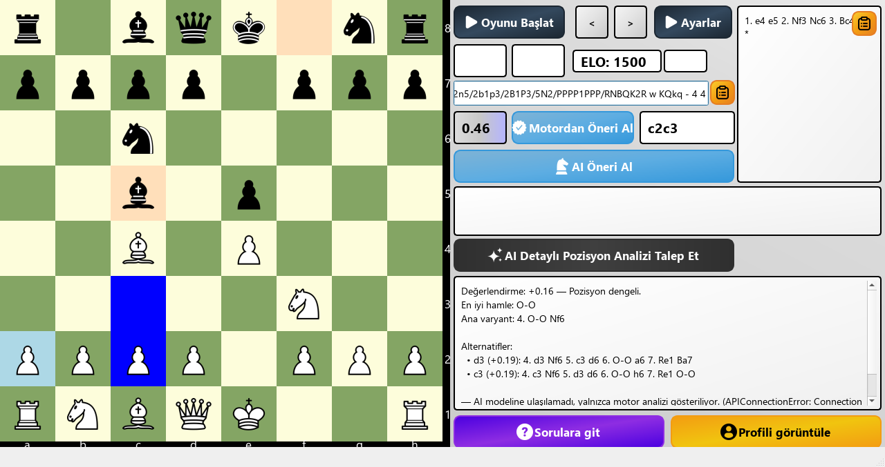
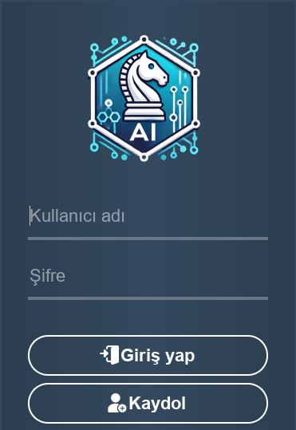
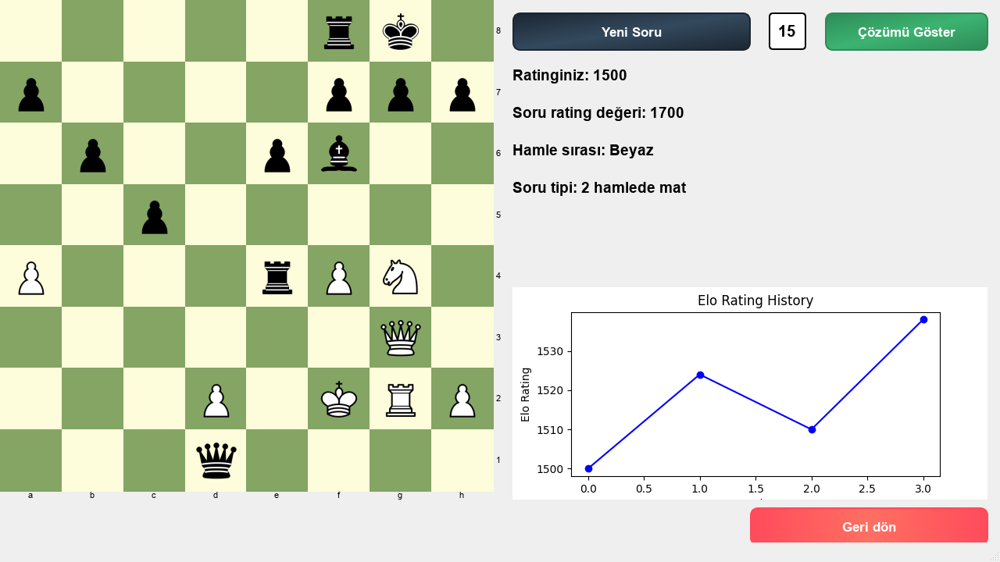

# ♞ Chessie — Stockfish + AI Position Explanations

A desktop chess training app built with **PyQt5** by **Eray Yıldırım** ([@erayildirim](https://github.com/erayildirim))
as a graduation project (*bitirme projesi*).
Play against a strength-adjusted Stockfish, solve rated mate-in-N puzzles, track your ELO,
and get **natural-language explanations of any position** from an AI model grounded in
Stockfish's analysis.

> The user interface is in Turkish 🇹🇷.

<p align="center">
  
</p>

| Login | Puzzles |
|---|---|
|  |  |

## Features

- **Play vs. Stockfish** — engine strength (`UCI_Elo`) follows your rating; time controls 1–20 min
- **Engine suggestions** — local Stockfish best move and live evaluation
- **Lichess cloud evaluation** — best line from the Lichess cloud database
- **AI position explanation** — Stockfish's top lines are sent to a language model which explains
  the plans, threats and evaluation in plain language (works with free/local models, see below)
- **Puzzles** — 77 mate-in-2/3/4 puzzles with a timer and a separate puzzle ELO
- **Profile** — ELO history charts, win rate, puzzle statistics, password change
- Move animations, sound effects, FEN/PGN copy, move undo/redo
- Accounts stored locally in SQLite with **PBKDF2-hashed passwords**

## Getting started

Requires **Python 3.9+**.

```bash
git clone https://github.com/erayildirim/chessie.git
cd chessie
pip install -r requirements.txt
```

### 1. Get Stockfish

Stockfish is GPL-licensed and is not included in this repo.
Download it from **https://stockfishchess.org/download/** and either

- extract it into a `Stockfish/` folder in the project root (it is found automatically), or
- install it so `stockfish` is on your `PATH`, or
- set `STOCKFISH_PATH` in a `.env` file (see `.env.example`).

### 2. Run

```bash
python run.py
```

Create an account with **Kaydol** (register), then log in. The database (`data/chess.db`)
is created automatically on first run and seeded with the puzzles.

## AI explanation ("AI Detaylı Pozisyon Analizi")

No API key is shipped with the app. Each user picks their own backend — any
**OpenAI-compatible** chat API works. Copy `.env.example` to `.env` and choose one:

| Backend | Cost | Setup |
|---|---|---|
| **[Ollama](https://ollama.com)** (default) | Free, runs locally, no key | `ollama pull llama3.2` — nothing else to configure |
| [Google Gemini](https://aistudio.google.com/apikey) | Free tier | set `AI_BASE_URL`, `AI_MODEL`, `AI_API_KEY` |
| [Groq](https://console.groq.com/keys) | Free tier | set `AI_BASE_URL`, `AI_MODEL`, `AI_API_KEY` |
| [OpenRouter](https://openrouter.ai) | Free models available | set `AI_BASE_URL`, `AI_MODEL`, `AI_API_KEY` |

If no model is reachable, the app still answers with an **engine-only explanation**
(evaluation, best move, main line and alternatives), so the button always works.

How it works: the position is analysed locally by Stockfish (MultiPV 3), and the FEN, material,
board diagram and engine lines are sent to the model with instructions to explain *only* what
the engine found. This keeps the model from inventing moves.

## Project structure

```
├── run.py                  # entry point
├── chess_trainer/
│   ├── app.py              # QApplication bootstrap
│   ├── login.py / register.py / profile_page.py
│   ├── game.py             # main board, engine play, AI features
│   ├── studies.py          # puzzle trainer
│   ├── ai_explainer.py     # Stockfish-grounded LLM explanations + fallback
│   ├── engine.py           # Stockfish discovery & strength limiting
│   ├── database.py         # SQLite schema, seeding, helpers
│   ├── auth.py             # password hashing
│   ├── config.py           # paths and .env settings
│   └── ui/                 # code generated from designer/*.ui (do not edit by hand)
├── designer/               # Qt Designer .ui files
├── assets/                 # images, chess pieces, sounds
├── data/puzzles.json       # puzzle set (the user database is created next to it)
├── tools/                  # UI build, puzzle scraping / import / validation scripts
└── docs/screenshots/
```

### Editing the UI

Edit the files in `designer/` with Qt Designer, then regenerate the Python code:

```bash
python tools/build_ui.py
```

### Puzzle tools

```bash
python tools/repair_puzzles.py   # validate every solution with Stockfish, re-export data/puzzles.json
python tools/import_puzzles.py <file.txt> <N>   # import mate-in-N puzzles from text
```

## Building a Windows executable

```bash
pip install pyinstaller
pyinstaller --noconfirm --windowed --name ChessTrainer ^
  --add-data "assets;assets" --add-data "data/puzzles.json;data" run.py
```

Then copy a `Stockfish/` folder (and optionally a `.env`) next to `dist/ChessTrainer/ChessTrainer.exe`,
zip the folder and attach it to a GitHub Release. If you include the Stockfish binary, also include
its `Copying.txt` and a link to its source code (GPL v3 requirement).

## Author & license

Copyright © 2024 **Eray Yıldırım** ([@erayildirim](https://github.com/erayildirim)).

Licensed under [GPL-3.0](LICENSE). Third-party assets and their licenses are listed in
[THIRD_PARTY_NOTICES.md](THIRD_PARTY_NOTICES.md).
